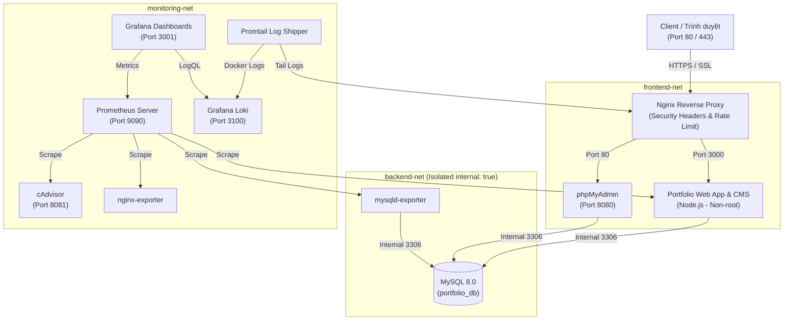

# ĐỀ TÀI 13: WEBSITE PORTFOLIO / GIỚI THIỆU CÁ NHÂN CÓ TRANG ADMIN QUẢN LÝ NỘI DUNG
**Môn học:** Triển khai và Quản trị Hệ thống Phần mềm (TKQT HTPM)  
**Trường:** Đại học Công nghệ Thông tin & Truyền thông - Đại học Thái Nguyên (ICTU)  
**Sinh viên thực hiện:** Nguyễn Duy Niên  
**Mã số sinh viên (MSSV):** DTC245200301  
**Lớp:** K23 - TKQT HTPM  
**Địa chỉ:** Kha Sơn, Phú Bình, Thái Nguyên  
**GitHub Repository:** [https://github.com/Deok37/nguyenduynien](https://github.com/Deok37/nguyenduynien)  

[](https://github.com/Deok37/nguyenduynien)

[](docker-compose.yml)
[](nginx/nginx.conf)
[](database/init.sql)
[](prometheus/prometheus.yml)
[](loki/loki-config.yml)
[-brightgreen?logo=shield)](docs/HARDENING_CHECKLIST.md)

---

## 📌 1. Giới thiệu Dự án

Dự án triển khai một hệ sinh thái hoàn chỉnh cho **Website Portfolio Cá Nhân** tích hợp **Bảng Điều Khiển Quản Trị (Admin CMS)** với các tiêu chuẩn công nghiệp hiện đại:
- **Giao diện Client (Portfolio):** Phong cách Dark Mode Glassmorphism hiện đại, tối ưu SEO, mượt mà trên mọi thiết bị.
- **Giao diện Quản trị (Admin CMS):** Xác thực an toàn bằng JWT + Bcrypt, cho phép người quản trị thêm, sửa, xóa (CRUD) các Dự án, Kỹ năng, cập nhật Profile và xem Hòm thư liên hệ từ khách truy cập.
- **Cơ sở dữ liệu:** MySQL 8.0 lưu trữ dữ liệu bền vững, kết hợp phpMyAdmin trực quan hóa CSDL.
- **Gateway & SSL:** Nginx làm Reverse Proxy, chuyển hướng HTTPS với chứng chỉ SSL tự ký, trang bị đầy đủ bộ Security Headers và Rate Limiting chống DoS.
- **Hệ thống Giám sát (Monitoring):** Prometheus thu thập metrics theo thời gian thực từ Web App, MySQL, Nginx và Docker Containers; Grafana trực quan hóa số liệu qua các Dashboards tự động nạp.
- **Quản lý Nhật ký tập trung (Centralized Logging):** Grafana Loki kết hợp Promtail thu thập log tập trung và hỗ trợ truy vấn điều tra sự cố bằng LogQL.
- **Bảo mật & Hardening:** Áp dụng toàn diện 6 biện pháp bảo mật: Non-root containers, Network isolation, Least privilege DB, Security headers, Rate limiting, Resource limits.

---

## 🏗️ 2. Sơ đồ Kiến trúc Hệ thống (System Architecture)



---

## 🚀 3. Hướng dẫn Khởi chạy Hệ thống (Quick Start)

### Điều kiện tiên quyết:
- Đã cài đặt **Docker Desktop** (hoặc Docker Engine & Docker Compose trên Linux/WSL2).
- Đã clone repository về máy tính.

### Bước 1: Khởi tạo tệp môi trường `.env`
Sao chép từ tệp `.env.example`:
```bash
cp .env.example .env
# Hoặc trên Windows PowerShell:
Copy-Item .env.example .env
```

### Bước 2: Khởi động toàn bộ các dịch vụ bằng Docker Compose
Chạy lệnh duy nhất để build và kích hoạt 11 container:
```bash
docker compose up -d
```

Kiểm tra trạng thái hoạt động của các container:
```bash
docker compose ps
```
> Tất cả các container phải ở trạng thái `running` hoặc `healthy`.

---

## 🌐 4. Bảng Tra cứu Cổng dịch vụ & Tài khoản truy cập

| Dịch vụ | Địa chỉ truy cập | Cổng (Port) | Tài khoản / Ghi chú |
|:---|:---|:---:|:---|
| **Website Portfolio (HTTPS)** | [https://localhost](https://localhost) | `443` | Giao diện công khai (chấp nhận SSL tự ký) |
| **Website Portfolio (HTTP)** | [http://localhost](http://localhost) | `80` | Tự động redirect 301 sang HTTPS |
| **Trang Đăng nhập Quản trị** | [https://localhost/login](https://localhost/login) | `443` | `admin` / `Admin@Secure2024!` |
| **Bảng điều khiển Admin CMS** | [https://localhost/admin](https://localhost/admin) | `443` | Quản trị dự án, kỹ năng, tin nhắn |
| **phpMyAdmin Web Tool** | [http://localhost:8080](http://localhost:8080) | `8080` | User: `portfolio_user` / `PortfolioUser@2024SecurePass`<br>Root: `root` / `RootSecurePass@2024!` |
| **Grafana Dashboards** | [http://localhost:3001](http://localhost:3001) | `3001` | `admin` / `GrafanaAdmin@2024Secure!` |
| **Prometheus Server** | [http://localhost:9090](http://localhost:9090) | `9090` | Xem Target Scrape & PromQL |
| **cAdvisor Container Metrics** | [http://localhost:8081](http://localhost:8081) | `8081` | Theo dõi hiệu năng container |
| **Web App Prometheus Metrics** | [http://localhost:3000/metrics](http://localhost:3000/metrics) | `3000` | Endpoint xuất chỉ số trực tiếp |

---

## 🔍 5. Truy vấn Nhật ký với LogQL (Loki + Promtail)

Truy cập Grafana tại `http://localhost:3001` $\rightarrow$ Chọn **Explore** $\rightarrow$ Datasource **Loki**:

1. **Lọc toàn bộ Access Log của Nginx:**
   ```logql
   {job="nginx"}
   ```
2. **Lọc các yêu cầu có mã lỗi HTTP $\ge$ 400:**
   ```logql
   {job="nginx"} | json | status >= 400
   ```
3. **Theo dõi các lần đăng nhập Admin CMS:**
   ```logql
   {job=~"nginx|docker-containers"} |= "/api/auth/login"
   ```
4. **Theo dõi các tin nhắn gửi qua Form liên hệ:**
   ```logql
   {job=~"nginx|docker-containers"} |= "POST /api/contact"
   ```
5. **Đo tần suất phát sinh cảnh báo lỗi theo thời gian:**
   ```logql
   sum(count_over_time({job=~"nginx|docker-containers"} |~ "(?i)(error|failed|warn)" [5m])) by (job)
   ```

*Xem tài liệu chi tiết tại:* [LOGQL_QUERIES.md](file:///docs/LOGQL_QUERIES.md)

---

## 🛡️ 6. Các biện pháp Hardening & Bảo mật (6 Biện pháp)

1. **Non-Root Containers:** Web App chạy bằng user `node` (UID 1000), Prometheus chạy user `nobody` (UID 65534), Loki chạy user unprivileged `10001:10001`.
2. **Network Isolation:** Mạng `backend-net` có cờ `internal: true`. Cổng MySQL 3306 **không** được publish ra máy chủ host.
3. **Database Least Privilege:** Tạo người dùng `portfolio_user` chỉ có quyền `SELECT, INSERT, UPDATE, DELETE` trên `portfolio_db.*`, tuyệt đối không cấp quyền quản trị hệ thống.
4. **Nginx Security Headers:** Cấu hình chuẩn OWASP: `X-Frame-Options`, `X-Content-Type-Options`, `X-XSS-Protection`, `Strict-Transport-Security`, `Referrer-Policy`, `server_tokens off;`.
5. **Rate Limiting & Anti-DDoS:** Áp dụng `limit_req_zone` 20 request/s để ngăn chặn brute force và tấn công từ chối dịch vụ.
6. **Resource Limits & Kernel Protection:** Giới hạn RAM/CPU trên từng container, ngăn ngừa cạn kiệt tài nguyên máy chủ (`no-new-privileges:true`).

*Xem tài liệu chi tiết tại:* [HARDENING_CHECKLIST.md](file:///docs/HARDENING_CHECKLIST.md)

---

## 📁 7. Cấu trúc Thư mục Dự án

```
portfolio-system/
├── docker-compose.yml              # File điều phối 11 services
├── .env.example                    # Template biến môi trường
├── .env                            # Biến môi trường bảo mật
├── .gitignore                      # Cấu hình bỏ qua tệp nhạy cảm
├── README.md                       # Hướng dẫn chi tiết dự án
├── app/                            # Mã nguồn Web Application (Node.js/Express)
│   ├── Dockerfile                  # Đóng gói non-root user
│   ├── package.json
│   ├── server.js                   # Web server + Prometheus metrics
│   ├── config/                     # Kết nối cơ sở dữ liệu MySQL
│   ├── routes/                     # Định tuyến API & Xác thực JWT
│   └── public/                     # Giao diện Frontend & Admin CMS
├── database/
│   └── init.sql                    # Script khởi tạo Schema, Seed data, Hardening DB
├── nginx/
│   ├── Dockerfile
│   ├── nginx.conf                  # Hardened Reverse Proxy + HTTPS
│   └── ssl/                        # Chứng chỉ SSL tự ký
├── prometheus/
│   ├── prometheus.yml              # Cấu hình scrape metrics
│   └── rules.yml                   # Cấu hình luật cảnh báo
├── grafana/
│   └── provisioning/               # Tự động nạp Datasource & Dashboards
├── loki/
│   └── loki-config.yml             # Cấu hình lưu trữ nhật ký tập trung
├── promtail/
│   └── promtail-config.yml         # Cấu hình thu thập log
├── docs/                           # Tài liệu báo cáo hoàn chỉnh
│   ├── BAO_CAO_TKQT_HTPM.md        # Báo cáo tổng hợp tối thiểu 10 trang
│   ├── LOGQL_QUERIES.md            # Hướng dẫn chi tiết LogQL
│   └── HARDENING_CHECKLIST.md      # Chi tiết 6 biện pháp Hardening
└── scripts/
    ├── init-git-commits.bat        # Script tự động tạo 03 commits Git chuẩn
    └── init-git-commits.sh
```

---

## 📦 8. Quản lý Mã nguồn trên GitHub (03 Commits)

Để tự động tạo Git repository với đúng 03 commits theo tiêu chí chấm điểm, chạy script:
```bash
# Trên Windows:
.\scripts\init-git-commits.bat

# Hoặc trên Linux/macOS:
bash scripts/init-git-commits.sh
```

Lịch sử commits sẽ bao gồm:
- **Commit 1:** `feat(init): trien khai website portfolio, mysql, phpmyadmin va nginx reverse proxy https`
- **Commit 2:** `feat(monitoring): tich hop he thong giam sat prometheus va grafana dashboard`
- **Commit 3:** `feat(logging-hardening): tich hop he thong log loki promtail, logql queries va hardening bao mat he thong`

Sau đó đẩy lên GitHub cá nhân (theo mã số sinh viên):
```bash
git remote add origin https://github.com/<MSSV>/portfolio-system.git
git branch -M main
git push -u origin main
```
