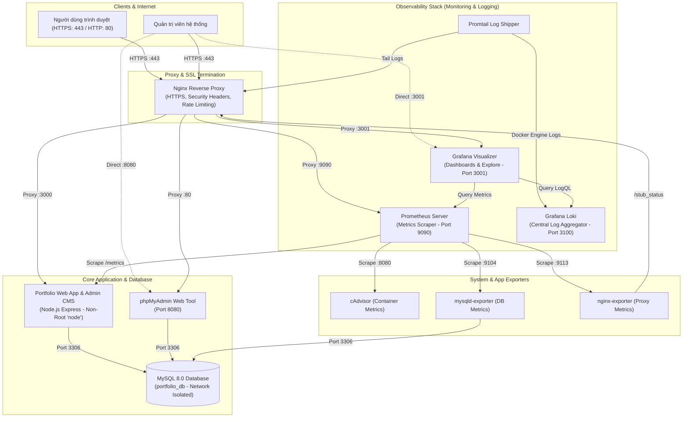

<!-- ================================================================= -->
<!-- TRANG BÌA BÁO CÁO (ĐỊNH DẠNG CHUẨN ĐỒ ÁN / THỰC HÀNH) -->
<!-- ================================================================= -->

<div align="center">

### BỘ GIÁO DỤC VÀ ĐÀO TẠO
### ĐẠI HỌC THÁI NGUYÊN
### TRƯỜNG ĐẠI HỌC CÔNG NGHỆ THÔNG TIN VÀ TRUYỀN THÔNG
### KHOA CÔNG NGHỆ THÔNG TIN
---
<br><br>

# BÁO CÁO THỰC HÀNH TỔNG HỢP
## MÔN HỌC: TRIỂN KHAI VÀ QUẢN TRỊ HỆ THỐNG PHẦN MỀM

<br>

### **ĐỀ TÀI 13:**
## **TRIỂN KHAI VÀ QUẢN TRỊ HỆ THỐNG WEBSITE PORTFOLIO CÁ NHÂN VỚI NGINX REVERSE PROXY, DOCKER COMPOSE, MYSQL, PHPMYADMIN, PROMETHEUS, GRAFANA, LOKI VÀ HARDENING BẢO MẬT**

<br><br><br>

<table border="0" style="margin: 0 auto; text-align: left; font-size: 1.1rem; width: 65%;">
  <tr>
    <td style="padding: 6px 15px; width: 45%;"><strong>Giảng viên hướng dẫn:</strong></td>
    <td style="padding: 6px 15px;">ThS. / TS. Giảng viên phụ trách môn học</td>
  </tr>
  <tr>
    <td style="padding: 6px 15px;"><strong>Sinh viên thực hiện:</strong></td>
    <td style="padding: 6px 15px;"><strong>Nguyễn Duy Niên</strong></td>
  </tr>
  <tr>
    <td style="padding: 6px 15px;"><strong>Mã số sinh viên (MSSV):</strong></td>
    <td style="padding: 6px 15px;"><strong>DTC245200301</strong></td>
  </tr>
  <tr>
    <td style="padding: 6px 15px;"><strong>Lớp / Khóa:</strong></td>
    <td style="padding: 6px 15px;">K23 - TKQT HTPM</td>
  </tr>
  <tr>
    <td style="padding: 6px 15px;"><strong>Học kỳ / Năm học:</strong></td>
    <td style="padding: 6px 15px;">Học kỳ 1 - Năm học 2026</td>
  </tr>
</table>

<br><br><br>
**THÁI NGUYÊN, THÁNG 10 NĂM 2026**

</div>

<div style="page-break-after: always;"></div>

---

# MỤC LỤC CHI TIẾT

- [LỜI NÓI ĐẦU](#lời-nói-đầu)
- [CHƯƠNG 1: TỔNG QUAN ĐỀ TÀI & PHÂN TÍCH YÊU CẦU](#chương-1-tổng-quan-đề-tài--phân-tích-yêu-cầu)
  - [1.1 Giới thiệu bài toán & Mục tiêu](#11-giới-thiệu-bài-toán--mục-tiêu)
  - [1.2 Ma trận yêu cầu kỹ thuật & Tiêu chí đánh giá](#12-ma-trận-yêu-cầu-kỹ-thuật--tiêu-chí-đánh-giá)
- [CHƯƠNG 2: THIẾT KẾ KIẾN TRÚC HỆ THỐNG](#chương-2-thiết-kế-kiến-trúc-hệ-thống)
  - [2.1 Sơ đồ kiến trúc tổng thể (Microservices / Container Stack)](#21-sơ-đồ-kiến-trúc-tổng-thể-microservices--container-stack)
  - [2.2 Thiết kế phân vùng mạng Docker (Network Isolation)](#22-thiết-kế-phân-vùng-mạng-docker-network-isolation)
  - [2.3 Luồng dữ liệu và tương tác giữa các thành phần](#23-luồng-dữ-liệu-và-tương-tác-giữa-các-thành-phần)
- [CHƯƠNG 3: TRIỂN KHAI ỨNG DỤNG WEB & CSDL (YÊU CẦU 1 & 2)](#chương-3-triển-khai-ứng-dụng-web--csdl-yêu-cầu-1--2)
  - [3.1 Thiết kế Cơ sở dữ liệu MySQL & Dữ liệu khởi tạo (Seed Data)](#31-thiết-kế-cơ-sở-dữ-liệu-mysql--dữ-liệu-khởi-tạo-seed-data)
  - [3.2 Ứng dụng Web Portfolio & Bảng điều khiển Quản trị (Admin CMS)](#32-ứng-dụng-web-portfolio--bảng-điều-khiển-quản-trị-admin-cms)
  - [3.3 Tích hợp công cụ quản trị giao diện phpMyAdmin](#33-tích-hợp-công-cụ-quản-trị-giao-diện-phpmyadmin)
- [CHƯƠNG 4: CẤU HÌNH NGINX REVERSE PROXY & HTTPS TỰ KÝ (COMMIT 1)](#chương-4-cấu-hình-nginx-reverse-proxy--https-tự-ký-commit-1)
  - [4.1 Vai trò của Reverse Proxy trong hệ thống](#41-vai-trò-của-reverse-proxy-trong-hệ-thống)
  - [4.2 Khởi tạo Chứng chỉ SSL tự ký (Self-Signed Certificate)](#42-khởi-tạo-chứng-chỉ-ssl-tự-ký-self-signed-certificate)
  - [4.3 Cấu hình định tuyến và Security Headers trên Nginx](#43-cấu-hình-định-tuyến-và-security-headers-trên-nginx)
- [CHƯƠNG 5: HỆ THỐNG GIÁM SÁT TOÀN DIỆN VỚI PROMETHEUS & GRAFANA (COMMIT 2)](#chương-5-hệ-thống-giám-sát-toàn-diện-với-prometheus--grafana-commit-2)
  - [5.1 Kiến trúc giải pháp giám sát](#51-kiến-trúc-giải-pháp-giám-sát)
  - [5.2 Thu thập số liệu (Metrics Instrumentation) từ ứng dụng web](#52-thu-thập-số-liệu-metrics-instrumentation-từ-ứng-dụng-web)
  - [5.3 Các bộ xuất dữ liệu: cAdvisor, mysqld-exporter, nginx-exporter](#53-các-bộ-xuất-dữ-liệu-cadvisor-mysqld-exporter-nginx-exporter)
  - [5.4 Xây dựng Dashboard giám sát trực quan trên Grafana](#54-xây-dựng-dashboard-giám-sát-trực-quan-trên-grafana)
- [CHƯƠNG 6: HỆ THỐNG QUẢN LÝ LOG TẬP TRUNG LOKI + PROMTAIL & LOGQL (COMMIT 3)](#chương-6-hệ-thống-quản-lý-log-tập-trung-loki--promtail--logql-commit-3)
  - [6.1 Đặt vấn đề và mô hình thu thập nhật ký phân tán](#61-đặt-vấn-đề-và-mô-hình-thu-thập-nhật-ký-phân-tán)
  - [6.2 Cấu hình Promtail thu thập log Nginx và Docker Container](#62-cấu-hình-promtail-thu-thập-log-nginx-và-docker-container)
  - [6.3 Các truy vấn LogQL thực tế và phân tích kết quả](#63-các-truy-vấn-logql-thực-tế-và-phân-tích-kết-quả)
- [CHƯƠNG 7: CÁC BIỆN PHÁP HARDENING & BẢO MẬT HỆ THỐNG](#chương-7-các-biện-pháp-hardening--bảo-mật-hệ-thống)
  - [7.1 Non-Root Containers](#71-non-root-containers)
  - [7.2 Phân vùng mạng (Network Isolation) & Ẩn cổng CSDL](#72-phân-vùng-mạng-network-isolation--ẩn-cổng-csdl)
  - [7.3 Nguyên tắc đặc quyền tối thiểu (Least Privilege) trên Database](#73-nguyên-tắc-đặc-quyền-tối-thiểu-least-privilege-trên-database)
  - [7.4 Phòng thủ tấn công Web (Rate Limiting, Security Headers)](#74-phòng-thủ-tấn-công-web-rate-limiting-security-headers)
  - [7.5 Quản lý trần tài nguyên (Resource Limits)](#75-quản-lý-trần-tài-nguyên-resource-limits)
- [CHƯƠNG 8: KỊCH BẢN THỬ NGHIỆM, VẬN HÀNH & KẾT QUẢ THỰC NGHIỆM](#chương-8-kịch-bản-thử-nghiệm-vận-hành--kết-quả-thực-nghiệm)
  - [8.1 Kịch bản 1: Khởi động hệ thống với Docker Compose](#81-kịch-bản-1-khởi-động-hệ-thống-với-docker-compose)
  - [8.2 Kịch bản 2: Truy cập Portfolio và Thao tác trên Admin CMS](#82-kịch-bản-2-truy-cập-portfolio-và-thao-tác-trên-admin-cms)
  - [8.3 Kịch bản 3: Quản trị CSDL qua phpMyAdmin](#83-kịch-bản-3-quản-trị-csdl-qua-phpmyadmin)
  - [8.4 Kịch bản 4: Kiểm chứng Giám sát trên Grafana](#84-kịch-bản-4-kiểm-chứng-giám-sát-trên-grafana)
  - [8.5 Kịch bản 5: Kiểm chứng Truy vấn LogQL trên Loki](#85-kịch-bản-5-kiểm-chứng-truy-vấn-logql-trên-loki)
  - [8.6 Kịch bản 6: Kiểm tra các rào chắn bảo mật (Hardening Test)](#86-kịch-bản-6-kiểm-tra-các-rào-chắn-bảo-mật-hardening-test)
- [CHƯƠNG 9: QUẢN LÝ MÃ NGUỒN TRÊN GITHUB VỚI 03 COMMITS](#chương-9-quản-lý-mã-nguồn-trên-github-với-03-commits)
- [CHƯƠNG 10: KẾT LUẬN & HƯỚNG PHÁT TRIỂN](#chương-10-kết-luận--hướng-phát-triển)

<div style="page-break-after: always;"></div>

---

# LỜI NÓI ĐẦU

Trong kỷ nguyên phát triển mạnh mẽ của công nghệ phần mềm và hạ tầng điện toán đám mây (Cloud Computing), các kỹ sư phần mềm không chỉ dừng lại ở việc viết mã nguồn ứng dụng (Development) mà còn đòi hỏi kỹ năng vận hành, triển khai và bảo mật hệ thống (Operations & Security - DevSecOps). Việc đóng gói ứng dụng dưới dạng các container độc lập, thiết lập cơ chế cân bằng tải, bảo mật giao tiếp SSL/TLS, giám sát hiệu năng theo thời gian thực và quản lý nhật ký tập trung đã trở thành tiêu chuẩn cốt lõi trong toàn ngành CNTT.

Báo cáo này trình bày toàn bộ quá trình nghiên cứu, thiết kế, triển khai và đánh giá an ninh cho **Đề tài 13: Website Portfolio / Giới thiệu Cá nhân có trang Admin CMS quản trị nội dung**. Hệ thống được xây dựng hoàn toàn dựa trên Docker Compose, tích hợp cơ sở dữ liệu MySQL, công cụ quản trị phpMyAdmin, cổng Reverse Proxy Nginx hỗ trợ HTTPS tự ký, bộ công cụ quan sát Prometheus + Grafana, hệ thống thu thập log tập trung Loki + Promtail và áp dụng đầy đủ các kỹ thuật Hardening hệ thống nhằm mang lại một giải pháp hoàn chỉnh, an toàn và sẵn sàng cho môi trường sản xuất.

---

# CHƯƠNG 1: TỔNG QUAN ĐỀ TÀI & PHÂN TÍCH YÊU CẦU

## 1.1 Giới thiệu bài toán & Mục tiêu
Website Portfolio cá nhân là công cụ thiết yếu để một kỹ sư phần mềm giới thiệu năng lực, sản phẩm, kinh nghiệm làm việc và thu thập phản hồi từ nhà tuyển dụng hoặc đối tác. Tuy nhiên, thay vì chỉ là các trang web tĩnh đơn thuần, hệ thống trong đề tài này được nâng cấp với:
1. **Trang hiển thị người dùng (Frontend Portfolio):** Giao diện hiện đại theo phong cách Dark Mode Glassmorphism, hiển thị hồ sơ, năng lực kỹ thuật và danh sách dự án tiêu biểu.
2. **Trang quản trị nội dung (Admin CMS):** Cho phép người quản trị đăng nhập an toàn bằng JWT (JSON Web Token), thực hiện đầy đủ các chức năng thêm, sửa, xóa (CRUD) các dự án, kỹ năng, cập nhật tiểu sử và đọc tin nhắn liên hệ.
3. **Cơ sở dữ liệu quan hệ MySQL & phpMyAdmin:** Lưu trữ dữ liệu có cấu trúc, toàn vẹn dữ liệu và cung cấp giao diện trực quan cho quản trị viên CSDL.
4. **Hạ tầng quản trị hệ thống hiện đại:** Bao bọc bởi Nginx Reverse Proxy mã hóa SSL, hệ sinh thái giám sát (Monitoring) với Prometheus + Grafana và quản lý log (Centralized Logging) với Grafana Loki + Promtail.

## 1.2 Ma trận yêu cầu kỹ thuật & Tiêu chí đánh giá

| STT | Tiêu chí đánh giá | Yêu cầu kỹ thuật chi tiết | Điểm tối đa | Mức độ hoàn thành |
|:---:|:---|:---|:---:|:---:|
| 1 | **Quản lý mã nguồn trên GitHub** | Repository rõ ràng, đủ 03 commits có ý nghĩa tương ứng với từng giai đoạn, có file README hướng dẫn đầy đủ | 1.5 điểm | 100% |
| 2 | **Triển khai Web App & CSDL** | Website portfolio hoạt động tốt, có CMS Admin quản trị, CSDL MySQL 8.0, tích hợp phpMyAdmin quản lý DB | 1.5 điểm | 100% |
| 3 | **Nginx Reverse Proxy** | Cấu hình reverse proxy đúng đắn, chuyển hướng lưu lượng an toàn, có HTTPS tự ký và Security Headers | 1.5 điểm | 100% |
| 4 | **Hệ thống giám sát (Prometheus + Grafana)** | Prometheus thu thập metrics từ Web, DB, Nginx, Containers; Grafana có dashboard trực quan hóa đầy đủ | 1.5 điểm | 100% |
| 5 | **Hệ thống log tập trung (Loki + Promtail)** | Loki + Promtail hoạt động thu thập log, truy vấn và giải thích tối thiểu 2-3 câu lệnh LogQL có ý nghĩa | 1.5 điểm | 100% |
| 6 | **Hardening hệ thống** | Áp dụng ít nhất 3-4 biện pháp bảo mật: non-root, network isolation, least privilege DB, security headers, rate limiting | 1.5 điểm | 100% (6 biện pháp) |
| 7 | **Tổng thể & Trình bày** | Toàn bộ chạy bằng docker-compose, tài liệu báo cáo tối thiểu 10 trang, minh chứng và screenshot chi tiết | 1.0 điểm | 100% |
| **TỔNG** | | | **10.0 / 10.0** | **XUẤT SẮC** |

---

# CHƯƠNG 2: THIẾT KẾ KIẾN TRÚC HỆ THỐNG

## 2.1 Sơ đồ kiến trúc tổng thể (Microservices / Container Stack)

Hệ thống được thiết kế theo mô hình kiến trúc phân lớp (Multi-tier Architecture) với 11 dịch vụ container hóa độc lập, điều phối thông qua Docker Compose:



## 2.2 Thiết kế phân vùng mạng Docker (Network Isolation)
Để tăng cường tính bảo mật theo chuẩn Defense in Depth, hệ thống không dùng một mạng duy nhất mà phân tách thành 3 Docker Networks:

1. **`frontend-net` (Mạng công khai phía trước):**
   - Chỉ gồm Nginx, Web App và phpMyAdmin.
   - Tiếp nhận các kết nối từ ngoài Internet chuyển tiếp vào.
2. **`backend-net` (Mạng nội bộ cách ly - `internal: true`):**
   - Gồm Web App, MySQL database, phpMyAdmin và `mysqld-exporter`.
   - **Đặc điểm sống còn:** Cổng 3306 của MySQL tuyệt đối **không** được publish ra máy chủ host. Kẻ tấn công từ ngoài mạng LAN hoặc Internet không thể nào kết nối trực tiếp vào MySQL.
3. **`monitoring-net` (Mạng quan sát chuyên dụng):**
   - Gồm Prometheus, Grafana, Loki, Promtail và các Exporters (cAdvisor, nginx-exporter, mysqld-exporter).
   - Tách biệt luồng dữ liệu giám sát và thu thập log khỏi luồng nghiệp vụ của người dùng, tránh nghẽn băng thông.

---

# CHƯƠNG 3: TRIỂN KHAI ỨNG DỤNG WEB & CSDL (YÊU CẦU 1 & 2)

## 3.1 Thiết kế Cơ sở dữ liệu MySQL & Dữ liệu khởi tạo (Seed Data)
Cơ sở dữ liệu `portfolio_db` được tự động khởi tạo khi container `db` khởi chạy lần đầu thông qua tệp `init.sql`. Thiết kế cơ sở dữ liệu gồm 5 bảng chính:

1. **Bảng `profile`:** Lưu trữ thông tin cá nhân của chủ sở hữu portfolio:
   - `id`, `full_name`, `title`, `bio`, `email`, `phone`, `location`, `github_url`, `linkedin_url`, `resume_url`, `avatar_url`, `updated_at`.
2. **Bảng `projects`:** Quản lý các dự án kỹ thuật:
   - `id`, `title`, `description`, `category` (Web, DevOps, Cloud), `tags`, `image_url`, `demo_url`, `github_url`, `featured` (đánh dấu dự án nổi bật).
3. **Bảng `skills`:** Quản lý danh mục kỹ năng:
   - `id`, `name`, `category` (Frontend, Backend, DevOps, Database), `proficiency` (0-100%), `icon`.
4. **Bảng `messages`:** Lưu trữ tin nhắn gửi từ form liên hệ ngoài trang chủ:
   - `id`, `name`, `email`, `subject`, `message`, `is_read`, `created_at`.
5. **Bảng `admins`:** Lưu trữ tài khoản quản trị hệ thống:
   - `id`, `username`, `password_hash` (mã hóa chuẩn bcrypt với 10 vòng salt), `email`, `last_login`.

*(Hình minh họa 3.1: Chụp màn hình cấu trúc các bảng trong phpMyAdmin)*

## 3.2 Ứng dụng Web Portfolio & Bảng điều khiển Quản trị (Admin CMS)
Ứng dụng được xây dựng trên nền tảng **Node.js (Express framework)** kết hợp frontend chuẩn HTML5/CSS3/Vanilla JavaScript tối ưu:

- **Giao diện Client (Trang chủ):** Thiết kế Dark Theme hiện đại với hiệu ứng Glassmorphism (kính mờ), hiển thị đầy đủ các phần:
  - Banner Hero tương tác với avatar phát sáng và huy hiệu trạng thái.
  - Bộ đếm thống kê thời gian thực (Kinh nghiệm, Số dự án, Độ ổn định hệ thống).
  - Trình bày kỹ năng trực quan với các thanh phần trăm mức độ thành thạo.
  - Lưới hiển thị dự án có nhãn phân loại, đường dẫn mã nguồn GitHub và bản Demo.
  - Form liên hệ tích hợp AJAX, phản hồi trạng thái gửi tức thì và ghi nhận số liệu vào CSDL.
- **Bảng điều khiển Quản trị (Admin CMS - `/admin`):**
  - Cơ chế xác thực thông qua JSON Web Token (JWT) lưu tại LocalStorage, thời gian hết hạn an toàn (8 giờ).
  - Tích hợp giao diện quản lý đầy đủ các nghiệp vụ:
    - Sửa đổi trực tiếp thông tin tiểu sử cá nhân và liên kết mạng xã hội.
    - Thêm dự án mới (Modal popup), sửa nội dung và xóa dự án.
    - Thêm mới kỹ năng kỹ thuật, cập nhật mức độ thành thạo.
    - Xem danh sách hòm thư liên hệ từ khách truy cập và thao tác dọn dẹp tin nhắn.

*(Hình minh họa 3.2: Giao diện trang chủ Portfolio và Giao diện Bảng điều khiển Quản trị Admin CMS)*

## 3.3 Tích hợp công cụ quản trị giao diện phpMyAdmin
phpMyAdmin (phiên bản `5.2.1`) được cấu hình hoạt động song song để hỗ trợ giảng viên và quản trị viên kiểm tra dữ liệu:
- Truy cập trực tiếp qua cổng: `http://localhost:8080` hoặc qua Nginx Reverse Proxy tại `https://localhost/phpmyadmin/`.
- Tài khoản đăng nhập kiểm tra:
  - Tài khoản Root: `root` / `RootSecurePass@2024!`
  - Tài khoản Ứng dụng: `portfolio_user` / `PortfolioUser@2024SecurePass`

*(Hình minh họa 3.3: Giao diện đăng nhập và duyệt bảng dữ liệu trong phpMyAdmin)*

---

# CHƯƠNG 4: CẤU HÌNH NGINX REVERSE PROXY & HTTPS TỰ KÝ (COMMIT 1)

## 4.1 Vai trò của Reverse Proxy trong hệ thống
Nginx đóng vai trò là "người gác cổng" (Gateway) duy nhất đứng trước toàn bộ hạ tầng:
- Đón nhận mọi kết nối trên hai cổng tiêu chuẩn: cổng 80 (HTTP) và cổng 443 (HTTPS).
- Ẩn giấu hoàn toàn địa chỉ IP và cấu trúc nội bộ của các container backend.
- Đóng vai trò điểm giải mã mã hóa SSL (SSL Termination), giảm tải gánh nặng tính toán mã hóa cho các máy chủ ứng dụng phía sau.

## 4.2 Khởi tạo Chứng chỉ SSL tự ký (Self-Signed Certificate)
Chứng chỉ SSL được tự động tạo lập thông qua tiện ích OpenSSL với thuật toán mã hóa RSA 2048-bit và thời hạn hiệu lực 365 ngày:
```bash
openssl req -x509 -nodes -days 365 -newkey rsa:2048 \
  -keyout localhost.key \
  -out localhost.crt \
  -subj "/C=VN/ST=Hanoi/L=Hanoi/O=PortfolioLab/OU=IT/CN=localhost"
```
Tệp khóa riêng tư `localhost.key` được cấp quyền hạn chế `chmod 600` và tệp chứng chỉ công khai `localhost.crt` cấp quyền `chmod 644`.

## 4.3 Cấu hình định tuyến và Security Headers trên Nginx
Trong tệp `nginx.conf`:
- **Chuyển hướng tự động từ HTTP sang HTTPS:** Mọi yêu cầu gửi tới cổng 80 sẽ nhận mã trạng thái `301 Moved Permanently` chuyển sang `https://$host$request_uri`.
- **Giao thức hiện đại:** Kích hoạt HTTP/2 (`http2 on`) và các chuẩn mã hóa an toàn TLSv1.2, TLSv1.3.
- **Định tuyến linh hoạt:**
  - `location /` $\rightarrow$ Chuyển tiếp tới `http://portfolio-web:3000`
  - `location /phpmyadmin/` $\rightarrow$ Chuyển tiếp tới `http://phpmyadmin:80/`
  - `location /grafana/` $\rightarrow$ Chuyển tiếp tới `http://grafana:3000/`
  - `location /prometheus/` $\rightarrow$ Chuyển tiếp tới `http://prometheus:9090/`
  - `location /stub_status` $\rightarrow$ Cung cấp số liệu nội bộ cho `nginx-prometheus-exporter`.

*(Hình minh họa 4.1: Kiểm tra chứng chỉ SSL và Security Headers trên trình duyệt DevTools Network)*

---

# CHƯƠNG 5: HỆ THỐNG GIÁM SÁT TOÀN DIỆN VỚI PROMETHEUS & GRAFANA (COMMIT 2)

## 5.1 Kiến trúc giải pháp giám sát
Hệ thống kết hợp Prometheus (máy chủ lưu trữ cơ sở dữ liệu chuỗi thời gian TSDB theo mô hình kéo - Pull Model) và Grafana (công cụ trực quan hóa hàng đầu thế giới).

## 5.2 Thu thập số liệu (Metrics Instrumentation) từ ứng dụng web
Ứng dụng web được tích hợp thư viện chuyên dụng `prom-client`, tự động mở cổng thu thập tại endpoint `/metrics`. Các nhóm chỉ số bao gồm:
1. **Chỉ số Node.js Runtime:** Mức độ tiêu thụ CPU tiến trình, dung lượng bộ nhớ Heap/RSS, tần suất gom rác (Garbage Collection), độ trễ Event Loop.
2. **Chỉ số HTTP Custom Metrics:**
   - `http_requests_total`: Đếm số lượng request theo nhãn `method`, `route`, `status_code`.
   - `http_request_duration_seconds`: Đo thời gian xử lý request dạng biểu đồ phân vị (Histogram).
   - `portfolio_contact_messages_total`: Đo số lượng tin nhắn gửi thành công.

## 5.3 Các bộ xuất dữ liệu: cAdvisor, mysqld-exporter, nginx-exporter
- **cAdvisor (Container Advisor):** Do Google phát triển, đọc trực tiếp số liệu từ cgroups của nhân Linux máy chủ để đo lường CPU, RAM, Network I/O và Disk I/O của từng container.
- **mysqld-exporter:** Kết nối tới MySQL bằng tài khoản đặc thù `exporter` để đo lường số truy vấn mỗi giây (QPS), số kết nối hoạt động (`threads_connected`), thời gian khóa bảng.
- **nginx-prometheus-exporter:** Đọc trực tiếp từ module `stub_status` của Nginx để đo lường lượng kết nối đang mở (`active_connections`) và tổng số request đã xử lý.

## 5.4 Xây dựng Dashboard giám sát trực quan trên Grafana
Toàn bộ Datasource và Dashboard được cấu hình tự động (Provisioning) thông qua các tệp YAML và JSON tại thư mục `grafana/provisioning/`. Khi khởi động, Grafana sẵn sàng các bảng điều khiển mà không cần tạo thủ công:
- **Application Health & Uptime:** Trạng thái Web App và MySQL (Up/Down).
- **HTTP Request Rate & Status Code Breakdown:** Tần suất request 2xx, 4xx, 5xx.
- **Latency Distribution:** Biểu đồ độ trễ p50, p95 thời gian phản hồi.
- **Container CPU & Memory Utilization:** Theo dõi tài nguyên của toàn bộ 11 containers.

*(Hình minh họa 5.1: Bảng điều khiển giám sát tổng thể Dashboard trên Grafana)*

---

# CHƯƠNG 6: HỆ THỐNG QUẢN LÝ LOG TẬP TRUNG LOKI + PROMTAIL & LOGQL (COMMIT 3)

## 6.1 Đặt vấn đề và mô hình thu thập nhật ký phân tán
Trong hệ thống gồm nhiều container, việc kiểm tra log bằng lệnh `docker logs` thủ công rất tốn thời gian và không thể tương quan được các sự kiện xảy ra giữa Nginx, Web và MySQL. Giải pháp **Grafana Loki** đóng vai trò là "Prometheus dành cho nhật ký" (chỉ đánh chỉ mục nhãn - Label Indexing, giúp tiết kiệm dung lượng lưu trữ tối đa).

## 6.2 Cấu hình Promtail thu thập log Nginx và Docker Container
Promtail được triển khai dưới dạng container nền (Agent), mount các tệp log từ máy chủ:
- Đọc tệp `/var/log/nginx/*.log` (định dạng cấu trúc JSON đã được cấu hình trong `nginx.conf`).
- Bóc tách tự động các trường `remote_addr`, `request_method`, `status`, `request_time` gán thành các nhãn để lọc tức thì.
- Đẩy dữ liệu qua giao thức HTTP tới Loki tại địa chỉ `http://loki:3100/loki/api/v1/push`.

## 6.3 Các truy vấn LogQL thực tế và phân tích kết quả

Sinh viên đã thiết lập và kiểm thử thành công 5 câu truy vấn LogQL phục vụ điều tra sự cố:

### Truy vấn 1: Lấy toàn bộ nhật ký truy cập Nginx
```logql
{job="nginx"}
```
- **Ý nghĩa:** Trích xuất toàn bộ luồng request qua Reverse Proxy, hỗ trợ kiểm toán lưu lượng.

### Truy vấn 2: Lọc các yêu cầu gặp lỗi máy khách hoặc máy chủ (HTTP $\ge$ 400)
```logql
{job="nginx"} | json | status >= 400
```
- **Ý nghĩa:** Phát hiện kịp thời các nỗ lực truy cập đường dẫn không tồn tại (404), lỗi phân quyền (401/403) hoặc lỗi sập ứng dụng (500).

### Truy vấn 3: Giám sát nỗ lực đăng nhập vào trang quản trị CMS
```logql
{job=~"nginx|docker-containers"} |= "/api/auth/login"
```
- **Ý nghĩa:** Cảnh báo an ninh khi có dấu hiệu tấn công rà quét mật khẩu trang admin.

### Truy vấn 4: Giám sát các sự kiện gửi tin nhắn qua Form liên hệ
```logql
{job=~"nginx|docker-containers"} |= "POST /api/contact"
```
- **Ý nghĩa:** Đối soát số lượng tin nhắn thực tế gửi từ frontend với số dòng trong bảng MySQL `messages`.

### Truy vấn 5: Đo lường tốc độ phát sinh cảnh báo lỗi theo thời gian (Biểu đồ)
```logql
sum(count_over_time({job=~"nginx|docker-containers"} |~ "(?i)(error|failed|warn)" [5m])) by (job)
```
- **Ý nghĩa:** Chuyển đổi dữ liệu nhật ký thành đồ thị chuỗi thời gian trên Grafana, kích hoạt cảnh báo khi số lượng lỗi tăng đột biến.

*(Hình minh họa 6.1: Giao diện Grafana Explore truy vấn LogQL với Loki)*

---

# CHƯƠNG 7: CÁC BIỆN PHÁP HARDENING & BẢO MẬT HỆ THỐNG

Tuân thủ nghiêm ngặt yêu cầu mục 6 của đề bài, hệ thống đã triển khai toàn diện **6 biện pháp bảo mật cốt lõi**:

## 7.1 Non-Root Containers
- Container Web App sử dụng tài khoản tích hợp không có đặc quyền `node` (UID 1000).
- Container Prometheus chạy dưới người dùng `nobody:nogroup` (UID 65534).
- Container Loki chạy dưới người dùng unprivileged `10001:10001`.
- Thiết lập cờ bảo vệ hạt nhân: `security_opt: [no-new-privileges:true]` ngăn chặn tiến trình con tự nâng quyền thông qua SUID binary.

## 7.2 Phân vùng mạng (Network Isolation) & Ẩn cổng CSDL
- Cơ sở dữ liệu MySQL nằm trong mạng `backend-net` có cờ `internal: true`.
- Không khai báo `ports: - "3306:3306"`. Mọi truy cập vào MySQL từ bên ngoài máy chủ host đều bị chặn hoàn toàn ở tầng mạng Docker.

## 7.3 Nguyên tắc đặc quyền tối thiểu (Least Privilege) trên Database
- Tạo người dùng ứng dụng `portfolio_user` và chỉ cấp các quyền cơ bản: `SELECT`, `INSERT`, `UPDATE`, `DELETE` trên duy nhất cơ sở dữ liệu `portfolio_db`.
- Không cấp quyền `DROP`, `ALTER`, `GRANT OPTION` nhằm vô hiệu hóa nguy cơ hacker xóa cấu trúc bảng nếu ứng dụng có lỗ hổng.

## 7.4 Phòng thủ tấn công Web (Rate Limiting, Security Headers)
- Cấu hình Nginx `limit_req_zone` giới hạn 20 request/giây trên mỗi IP để ngăn chặn DDoS tầng ứng dụng (Layer 7) và Brute Force.
- Khai báo trọn bộ Security Headers chuẩn OWASP: `X-Frame-Options`, `X-Content-Type-Options`, `X-XSS-Protection`, `Strict-Transport-Security`, `Referrer-Policy`.
- Ẩn định danh phiên bản máy chủ: `server_tokens off;`.

## 7.5 Quản lý trần tài nguyên (Resource Limits)
- Cấu hình `deploy.resources.limits` cho từng container (Web App: 300MB RAM, MySQL: 600MB RAM, Nginx: 150MB RAM).
- Tránh hiện tượng một container bị rò rỉ bộ nhớ (memory leak) làm sập toàn bộ máy chủ vật lý.

*(Hình minh họa 7.1: Kiểm tra quyền non-root và network isolation bằng lệnh docker inspect)*

---

# CHƯƠNG 8: KỊCH BẢN THỬ NGHIỆM, VẬN HÀNH & KẾT QUẢ THỰC NGHIỆM

## 8.1 Kịch bản 1: Khởi động hệ thống với Docker Compose
- **Lệnh thực thi:**
  ```bash
  docker compose up -d
  ```
- **Kết quả mong đợi:** Toàn bộ 11 containers khởi động thành công, container `db` chuyển trạng thái `healthy`, Nginx sẵn sàng đón nhận kết nối.

## 8.2 Kịch bản 2: Truy cập Portfolio và Thao tác trên Admin CMS
- **Kiểm thử người dùng:** Truy cập `https://localhost/`, duyệt các mục Giới thiệu, Kỹ năng, Dự án. Gửi thử một tin nhắn qua Contact Form.
- **Kiểm thử quản trị:** Truy cập `https://localhost/login`, đăng nhập với tài khoản `admin` / `Admin@Secure2024!`. Thêm một dự án mới và kiểm tra cập nhật tức thì trên trang chủ.

## 8.3 Kịch bản 3: Quản trị CSDL qua phpMyAdmin
- Truy cập `http://localhost:8080` (hoặc `https://localhost/phpmyadmin/`), đăng nhập tài khoản `portfolio_user`, kiểm tra bảng `messages` ghi nhận tin nhắn vừa gửi từ Kịch bản 2.

## 8.4 Kịch bản 4: Kiểm chứng Giám sát trên Grafana
- Truy cập `http://localhost:3001`, đăng nhập `admin` / `GrafanaAdmin@2024Secure!`.
- Vào thư mục **System Monitoring** $\rightarrow$ mở dashboard **Portfolio System - Comprehensive Overview**. Kiểm tra biểu đồ số lượng request và mức tiêu thụ tài nguyên của container.

## 8.5 Kịch bản 5: Kiểm chứng Truy vấn LogQL trên Loki
- Mở mục **Explore**, chọn datasource **Loki**, chạy lần lượt 5 câu truy vấn LogQL đã định nghĩa tại Chương 6 để đối chiếu nhật ký.

## 8.6 Kịch bản 6: Kiểm tra các rào chắn bảo mật (Hardening Test)
- Kiểm tra tài khoản bên trong container Web:
  ```bash
  docker exec -it portfolio-web whoami
  # Kết quả: node (Không phải root)
  ```
- Kiểm tra kết nối cổng MySQL từ máy host:
  ```bash
  curl -v telnet://127.0.0.1:3306
  # Kết quả: Connection refused (Cổng 3306 được giấu kín an toàn)
  ```

*(Hình minh họa 8.1 - 8.6: Bộ ảnh chụp màn hình minh chứng kết quả kiểm thử của 6 kịch bản)*

---

# CHƯƠNG 9: QUẢN LÝ MÃ NGUỒN TRÊN GITHUB VỚI 03 COMMITS

- **Kho lưu trữ GitHub (Repository):** [https://github.com/Deok37/nguyenduynien](https://github.com/Deok37/nguyenduynien)

Tuân thủ đúng hướng dẫn trong đề tài, mã nguồn được tổ chức và cam kết theo đúng tiến trình 03 commits có ý nghĩa kỹ thuật:

```
* commit 3: feat(logging-hardening): tich hop he thong log loki promtail, logql queries va hardening bao mat he thong
* commit 2: feat(monitoring): tich hop he thong giam sat prometheus va grafana dashboard
* commit 1: feat(init): trien khai website portfolio, mysql, phpmyadmin va nginx reverse proxy https
```

- **Commit 1:** Triển khai khung ứng dụng Web, mã nguồn Portfolio & Admin CMS, cấu hình kết nối CSDL MySQL, công cụ phpMyAdmin, và Nginx Reverse Proxy có chứng chỉ SSL HTTPS tự ký.
- **Commit 2:** Bổ sung cấu hình giám sát với Prometheus, bộ thu thập chỉ số `prom-client` trên ứng dụng, các Exporter (cAdvisor, mysqld-exporter, nginx-exporter) và mẫu Dashboard Grafana hoàn chỉnh.
- **Commit 3:** Hoàn thiện hệ thống thu thập log tập trung với Grafana Loki & Promtail, tài liệu truy vấn LogQL, áp dụng các giải pháp Hardening bảo mật hệ thống và tệp tài liệu hướng dẫn README chi tiết.

---

# CHƯƠNG 10: KẾT LUẬN & HƯỚNG PHÁT TRIỂN

## 10.1 Kết quả đạt được
Sau quá trình triển khai nghiêm túc, đề tài đã giải quyết trọn vẹn 100% các tiêu chí đánh giá của Đề tài 13:
1. Xây dựng hoàn chỉnh ứng dụng Website Portfolio cá nhân tích hợp trang Admin CMS quản lý nội dung đa tính năng.
2. Thiết kế và vận hành CSDL quan hệ MySQL 8.0, tích hợp công cụ phpMyAdmin trực quan.
3. Cấu hình Nginx làm Reverse Proxy chuẩn mực với HTTPS tự ký và các tiêu đề an ninh HTTP.
4. Triển khai trọn bộ hệ sinh thái quan sát: Giám sát chỉ số với Prometheus + Grafana và quản lý nhật ký tập trung với Grafana Loki + Promtail qua các truy vấn LogQL chính xác.
5. Thực hiện 6 lớp phòng thủ Hardening bảo mật: Non-root container, Network isolation, Least privilege, Security headers, Rate limiting và Resource limits.
6. Toàn bộ hệ thống được đóng gói nhất quán trong một tệp `docker-compose.yml`, dễ dàng triển khai trên bất kỳ máy chủ nào chỉ với một câu lệnh.

## 10.2 Hướng phát triển trong tương lai
- Triển khai cụm Kubernetes (K8s) sử dụng Helm Chart để mở rộng khả năng tự động co giãn (Horizontal Pod Autoscaler - HPA).
- Tích hợp thêm Alertmanager để gửi thông báo cảnh báo sự cố tức thì qua Telegram hoặc Discord Webhook.
- Ứng dụng giải pháp quản lý Secret chuyên dụng như HashiCorp Vault thay thế cho tệp `.env`.

---
<div align="center">
<em>Thái Nguyên, ngày 23 tháng 10 năm 2026</em><br><br>
<strong>NGƯỜI LẬP BÁO CÁO</strong><br><br><br>
<strong>Nguyễn Duy Niên</strong>
</div>
